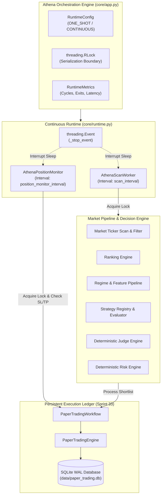

# ATHENA Continuous Runtime & Active Position Monitoring

**Status:** IMPLEMENTED & VERIFIED  
**Sprint:** 34  
**Operating Mode:** STRICT PAPER / SIMULATION ONLY  
**Live Trading:** STRICTLY PROHIBITED  
**Baseline Test Suite:** 352 / 352 PASSED  

---

## 1. Overview and Architecture

Sprint 34 upgrades ATHENA from a single-pass CLI evaluation engine into a robust, event-driven, production-grade **Continuous Paper Runtime**. The runtime orchestrates concurrent background scanning, real-time position monitoring, and thread-safe persistent accounting, while preserving 100% backward compatibility with one-shot CLI execution.

### Architectural Diagram



---

## 2. Core Components

### 2.1 ContinuousRuntime (`core/runtime.py`)
- **Worker Management:** Launches managed, non-daemon worker threads (`AthenaScanWorker` and `AthenaPositionMonitor`).
- **Mutual Exclusion:** Coordinates ledger access via a shared `threading.RLock`. Scan workflow execution and active position monitoring cannot race on portfolio equity or position state.
- **Responsive Shutdown:** Sleep periods utilize `_stop_event.wait(timeout=...)` rather than blocking `time.sleep()`. Upon receiving a stop signal (`SIGINT`, `SIGTERM`, deadline, max cycles, or programmatic `stop()`), workers wake and terminate in sub-second intervals (< 1.0s) without waiting for sleep intervals to expire.
- **Safety Enforcement:** The runtime checks `TRADING_MODE == "SIMULATION"` upon startup. If `TRADING_MODE` is set to any other value, startup fails immediately with `RuntimeError`.

### 2.2 PositionMonitor (`core/runtime.py`)
- **Active Scanning:** Queries active positions via `workflow.get_open_positions()`. If no open positions exist, public API polling is skipped entirely.
- **Targeted Symbol Polling:** Identifies unique symbols requiring fresh price updates and polls public Bitget endpoints via `MarketData.get_ticker(symbol)`.
- **Fault-Tolerant Retries:** Ticker queries employ exponential backoff retries (`MAX_RETRY_ATTEMPTS = 3`, `RETRY_BACKOFF_SECONDS = 1.0`). If an endpoint fails or returns malformed/zero prices, the monitor logs the incident and skips the update. Missing or invalid data is never treated as a valid market price; open positions remain intact.
- **Protective Exit Triggering:** Calls `workflow.update_market_price()` and `workflow.process_candle()`. When market prices cross configured `stop_loss_price` or `take_profit_price` levels, orders are atomically closed, net PnL is computed, and closed trades are committed to SQLite storage.

### 2.3 Athena Orchestrator (`core/app.py`)
- **Unified Entry Points:**
  - `run_once()`: Executes a single market analysis cycle and position monitoring pass. Formats and prints legacy console tables, preserving 100% backward compatibility.
  - `run_continuous()`: Starts the multi-threaded continuous runtime, polling opportunities and positions continuously until commanded to stop.
  - `run()`: Dynamic dispatcher executing `run_continuous()` if `RUNTIME_MODE == "CONTINUOUS"` or `run_once()` if `RUNTIME_MODE == "ONE_SHOT"`.
  - `stop(reason)`: Unblocks workers, joins worker threads, flushes database write-ahead logs, and restores signal handlers.

---

## 3. Configuration Parameters (`config/settings.py`)

| Parameter | Type | Default | Description |
|:---|:---|:---|:---|
| `RUNTIME_MODE` | `str` | `"ONE_SHOT"` | Operating mode: `"ONE_SHOT"` (single pass) or `"CONTINUOUS"` (uninterrupted loop) |
| `SCAN_INTERVAL` | `float` | `5.0` | Sleep interval in seconds between market scan cycles |
| `POSITION_MONITOR_INTERVAL` | `float` | `1.0` | Polling interval in seconds for active position SL/TP checks |
| `MAX_RETRY_ATTEMPTS` | `int` | `3` | Maximum retry attempts for public ticker API calls |
| `RETRY_BACKOFF_SECONDS` | `float` | `1.0` | Base exponential backoff multiplier for API retries |
| `MAX_CYCLES` | `int \| None` | `None` | Optional cycle limit for bounded test or calibration runs |
| `MAX_DURATION_SECONDS` | `float \| None` | `None` | Optional execution deadline in seconds |

---

## 4. Telemetry and Operational Metrics

`RuntimeMetrics` tracks real-time execution health:

```python
@dataclass
class RuntimeMetrics:
    cycles_completed: int = 0
    cycles_failed: int = 0
    monitor_checks_completed: int = 0
    monitor_checks_failed: int = 0
    positions_closed_by_sl: int = 0
    positions_closed_by_tp: int = 0
    positions_closed_total: int = 0
    total_candidates_scanned: int = 0
    total_orders_filled: int = 0
    start_time: datetime | None = None
    stop_time: datetime | None = None
    last_scan_duration: float = 0.0
    last_monitor_duration: float = 0.0
    is_running: bool = False
    exit_reason: str = "NONE"
```

---

## 5. Automated Verification Summary

All 352 unit and integration tests execute deterministically without network calls:

1. **Configuration Validation:** Validates strictly positive intervals, non-negative retries, and mode parsing.
2. **Safety Locks:** Confirms live trading prohibition fails closed with explicit `RuntimeError`.
3. **One-Shot Execution:** Verifies `run_once()` completes scans, prints formatted summaries, and returns `(results, trades)`.
4. **Continuous Scheduling:** Verifies bounded execution via `max_cycles` and `max_duration_seconds`.
5. **Protective Exits:** Simulates price breaches triggering Stop-Loss and Take-Profit exits with persistent ledger updates.
6. **API Resilience:** Verifies transient network timeouts and malformed payloads are safely retried and skipped.
7. **Thread Safety:** Verifies mutual exclusion under concurrent load with zero ledger races.
8. **Restart Recovery:** Proves portfolio cash, reserved margin, and positions survive full application stop and reboot.
9. **Responsive Shutdown:** Verifies sub-second (< 1.0s) worker interruption during long sleep intervals.
