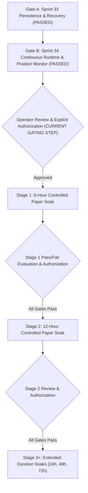

# ATHENA Staged Paper Soak Roadmap & Readiness Handoff

**Status:** GATES A & B PASSED — READY FOR STAGE 1 OPERATOR AUTHORIZATION  
**Mode:** PAPER / SIMULATION ONLY  
**Current Phase:** Sprint 34 Completed (Continuous Runtime & Position Monitoring Passed)  
**Live Trading:** STRICTLY PROHIBITED  

---

## 1. Purpose

This document formalizes the staged progression roadmap for controlled paper soak operations in ATHENA. 

> [!IMPORTANT]
> **No soak was authorized or launched during Sprint 34.**
> This roadmap defines the governance, gating, evaluation criteria, and staged duration progression required before any long-running paper soak may be executed. Both Gate A (Persistence & Recovery) and Gate B (Continuous Runtime & Position Monitoring) are now fully implemented and verified. Stage 1 (6-Hour Controlled Paper Soak) is the next milestone, requiring explicit operator review and authorization.

---

## 2. Soak Gating Sequence

### Gate A: Sprint 33 — Persistence & Recovery (COMPLETED & VERIFIED)
- **Objective:** Durable SQLite ledger persistence with WAL mode, restart recovery, idempotency preservation, and atomic transaction rollback.
- **Status:** **PASSED & VERIFIED** (Commit `12f81393f292bbd6b0b51387ac280952d8e4d993`).

### Gate B: Sprint 34 — Continuous Runtime & Position Monitoring (COMPLETED & VERIFIED)
- **Objective:**
  1. Implement continuous scanning / runtime loop with configurable interval in `core/app.py` and `core/runtime.py`.
  2. Implement active position monitoring worker to periodically fetch public market prices and trigger `update_market_price()` and `process_candle()` for all open positions.
  3. Implement responsive graceful shutdown handlers (`SIGINT` / `SIGTERM` / deadline / max cycles) with sub-second wakeups and ledger flushing.
  4. Comprehensive unit test coverage for runtime orchestrator in `tests/test_app.py` (352/352 tests passed).
- **Status:** **PASSED & VERIFIED**.

---

## 3. Staged Soak Progression

### Stage 1: Six-Hour Controlled Paper Soak (NEXT STEP UPON AUTHORIZATION)
- **Duration:** 6 hours uninterrupted (or safety stop condition triggered).
- **Execution Mode:** `TRADING_MODE = "SIMULATION"`, persistent SQLite ledger enabled.
- **Evaluation Dimensions:**
  1. **Runtime Continuity:** Zero unhandled crashes; process maintains continuous polling.
  2. **Market Data Resilience:** Graceful handling of public Bitget HTTP timeouts, retries, and rate limits.
  3. **Candidate Traceability:** Full audit trail for all scanned tickers, ranking scores, strategy selections, judge decisions, and risk verdicts.
  4. **Protective Exit Execution:** Active monitoring triggers Stop-Loss or Take-Profit orders upon live price crosses.
  5. **Accounting Integrity:** Cash, reserved margin, and total equity remain synchronized with zero drift.
  6. **Idempotency & Restarts:** Mid-soak restart test to verify position recovery and duplicate prevention.
  7. **System Resource Usage:** Stable CPU and memory consumption without memory leaks.
  8. **Safety Boundary:** Strict verification that zero private exchange endpoints or real orders are touched.

### Stage 2: Twelve-Hour Controlled Paper Soak
- **Prerequisites:**
  1. Stage 1 completed full protocol and final report reviewed.
  2. All mandatory Stage 1 pass criteria satisfied.
  3. Any identified defects remediated with regression tests passed.
  4. Explicit operator authorization.
- **Policy:** Never automatically chain from Stage 1 to Stage 2.

### Stage 3 and Beyond: Gradual Duration Increases
- Only after Stage 2 passes may longer soaks (24h, 48h, 72h) be scheduled.
- Each stage requires its own documented pass/fail criteria and explicit operator sign-off.

---

## 4. Safety Stop Conditions

A soak run must immediately terminate if any of the following occur:
1. Attempted connection to any private exchange trading endpoint.
2. In-memory and persistent database state divergence.
3. Violation of portfolio accounting identity (`Total Equity != Cash + Reserved Margin + Unrealized PnL`).
4. Rapid drawdown exceeding risk policy threshold (e.g. 10% account equity drop).
5. Unhandled exception in the core loop that leaves positions unmonitored.

---

## 5. Summary Statement

Sprint 34 successfully completes the continuous runtime architecture, active position monitoring engine, thread-safe synchronization, and responsive graceful shutdown (Gate B). The ATHENA system is now structurally, logically, and persistenly complete for paper trading execution. It is handed off to the Operator and Product Owner for review and explicit authorization prior to initiating Stage 1 (6-hour controlled paper soak).
