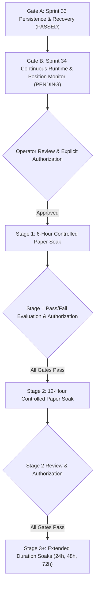

# ATHENA Staged Paper Soak Roadmap & Readiness Handoff

**Status:** HANDOFF FOR FUTURE SOAK EXECUTION  
**Mode:** PAPER / SIMULATION ONLY  
**Current Phase:** Sprint 33 (Persistence & Recovery Gate Passed)  
**Live Trading:** STRICTLY PROHIBITED  

---

## 1. Purpose

This document formalizes the staged progression roadmap for controlled paper soak operations in ATHENA. 

> [!IMPORTANT]
> **No soak is authorized or launched during Sprint 33.**
> This roadmap defines the governance, gating, evaluation criteria, and staged duration progression required before any long-running paper soak may be executed.

---

## 2. Soak Gating Sequence

### Gate A: Sprint 33 — Persistence & Recovery (COMPLETED)
- **Objective:** Durable SQLite ledger persistence with WAL mode, restart recovery, idempotency preservation, and atomic transaction rollback.
- **Status:** **PASSED & VERIFIED**.

### Gate B: Sprint 34 — Continuous Runtime & Position Monitoring (NEXT SPRINT)
- **Objective:**
  1. Implement continuous scanning / runtime loop with configurable interval in `core/app.py`.
  2. Implement active position monitoring worker to periodically fetch market prices and trigger `update_market_price()` and `process_candle()` for all open positions.
  3. Implement graceful shutdown handlers (`SIGINT` / `SIGTERM`) with ledger flushing.
  4. Unit test coverage for runtime orchestrator (`tests/test_app.py`).
- **Status:** **REQUIRED BEFORE STAGE 1 SOAK**.

---

## 3. Staged Soak Progression

### Stage 1: Six-Hour Controlled Paper Soak
- **Duration:** 6 hours uninterrupted (or safety stop condition triggered).
- **Execution Mode:** `TRADING_MODE = "SIMULATION"`, persistent SQLite ledger enabled.
- **Evaluation Dimensions:**
  1. **Runtime Continuity:** Zero unhandled crashes; process maintains continuous polling.
  2. **Market Data Resilience:** Graceful handling of public Bitget HTTP timeouts, retries, and rate limits.
  3. **Candidate Traceability:** Full audit trail for all scanned tickers, ranking scores, strategy selections, judge decisions, and risk verdicts.
  4. **Protective Exit Execution:** Active monitoring triggers Stop-Loss or Take-Profit orders upon live price crosses.
  5. **Accounting Integrity:** Cash, reserved margin, and total equity remain synchronized with zero drift.
  6. **Idempotency & Restarts:** Mid-soak restart test to verify position recovery and duplicate prevention.
  7. **System Resource Usage:** Stable CPU and memory consumption without memory leaks.
  8. **Safety Boundary:** Strict verification that zero private exchange endpoints or real orders are touched.

### Stage 2: Twelve-Hour Controlled Paper Soak
- **Prerequisites:**
  1. Stage 1 completed full protocol and final report reviewed.
  2. All mandatory Stage 1 pass criteria satisfied.
  3. Any identified defects remediated with regression tests passed.
  4. Explicit operator authorization.
- **Policy:** Never automatically chain from Stage 1 to Stage 2.

### Stage 3 and Beyond: Gradual Duration Increases
- Only after Stage 2 passes may longer soaks (24h, 48h, 72h) be scheduled.
- Each stage requires its own documented pass/fail criteria and explicit operator sign-off.

---

## 4. Safety Stop Conditions

A soak run must immediately terminate if any of the following occur:
1. Attempted connection to any private exchange trading endpoint.
2. In-memory and persistent database state divergence.
3. Violation of portfolio accounting identity (`Total Equity != Cash + Reserved Margin + Unrealized PnL`).
4. Rapid drawdown exceeding risk policy threshold (e.g. 10% account equity drop).
5. Unhandled exception in the core loop that leaves positions unmonitored.

---

## 5. Summary Statement

Sprint 33 completes the fundamental data architecture (Gate A) required for durable paper trading. The system is handed off to **Sprint 34** for runtime loop and position monitoring implementation, prior to any soak execution.
