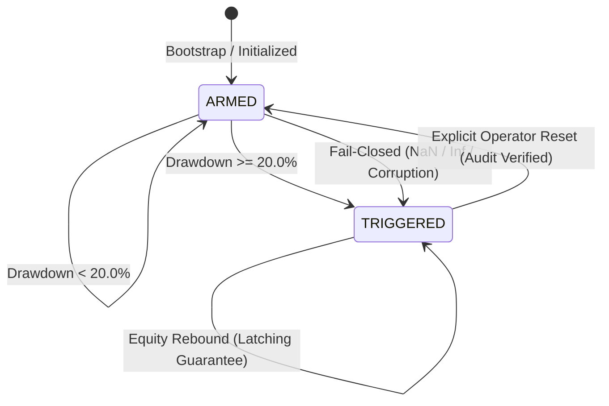

# Persistent Portfolio Drawdown Circuit Breaker

**Component:** ATHENA Risk & Safety Architecture  
**Module:** `risk/circuit_breaker.py`  
**Integration Points:** `execution/paper_engine.py`, `execution/paper_workflow.py`, `execution/paper_persistence.py`, `core/runtime.py`, `core/app.py`  
**Operating Mode:** STRICT PAPER / SIMULATION ONLY  
**Live Trading:** PROHIBITED  

---

## 1. Executive Summary & Purpose

The **Persistent Portfolio Drawdown Circuit Breaker** is an authoritative capital protection contract in ATHENA. It enforces a strict maximum allowable portfolio drawdown limit against a durably tracked equity High-Water Mark (HWM).

When portfolio equity falls by **20.0% or more** from its historical high-water mark, the circuit breaker immediately latches into a `TRIGGERED` state:
1. **Entry Blocker:** Immediately blocks all new trade opportunities, shortlist evaluations, and execution requests across both workflow and execution engine boundaries.
2. **Active Protection:** Keeps active position monitoring alive to protect existing positions until closed via Stop-Loss, Take-Profit, or manual exit.
3. **Controlled Graceful Shutdown:** Once all open positions are closed (flat), terminates continuous runtime workers cleanly with exit reason `CIRCUIT_BREAKER_TRIGGERED`.
4. **Durable Latching:** Persists trigger state to SQLite. The breaker survives process reboots and **cannot** be cleared automatically by market rebounds or restarts.
5. **Fail-Closed Design:** Any non-finite arithmetic (NaN, Inf), schema corruption, or persistence error triggers the fail-closed latch immediately.

---

## 2. Quantitative Accounting Specification

### 2.1 Accounting Identity

Portfolio equity is computed dynamically under the linear USDT-margined futures model:

$$\text{Total Equity} = \text{Cash} + \text{Reserved Margin} + \text{Unrealized PnL}$$

- **Cash:** Unencumbered liquid USDT balance, updated after fee deduction and realized PnL.
- **Reserved Margin:** Sum of initial margin committed to active open positions:
  $$\text{Reserved Margin} = \sum_{p \in \text{OpenPositions}} \text{RequiredMargin}(p)$$
- **Unrealized PnL:** Mark-to-market floating profit or loss across all open positions:
  - Long: $(\text{Mark Price} - \text{Entry Price}) \times \text{Quantity} \times \text{Multiplier}$
  - Short: $(\text{Entry Price} - \text{Mark Price}) \times \text{Quantity} \times \text{Multiplier}$

This identity guarantees that fees paid and realized losses directly depress cash, avoiding double-counting while capturing true net portfolio liquidation value.

### 2.2 High-Water Mark (HWM) Tracking

- Initialized to starting equity (default: 10,000.00 USDT) upon fresh database creation.
- Upon each portfolio state change (fill, close, mark tick, candle update):
  $$\text{If } \text{Total Equity} > \text{HWM} \implies \text{HWM} \leftarrow \text{Total Equity}$$

### 2.3 Drawdown & Trigger Formula

$$\text{Drawdown Fraction} = \frac{\text{HWM} - \text{Total Equity}}{\text{HWM}}$$
$$\text{Drawdown \%} = \text{Drawdown Fraction} \times 100.0$$

The circuit breaker triggers when:
$$\text{Drawdown \%} \ge \text{MAX\_PORTFOLIO\_DRAWDOWN\_PCT} \quad (20.0\%)$$

---

## 3. Architecture & State Machine



### 3.1 States

- `ARMED`: Normal operation. Evaluating every equity change against HWM and threshold. New entries permitted.
- `TRIGGERED`: Latched safety lockdown. All new entries blocked at both workflow and engine layers. Existing positions monitored until flat.
- `RESET`: Ephemeral audit transition during authorized operator reset. Re-anchors HWM to current equity and transitions to `ARMED`.

---

## 4. Multi-Layer Defense in Depth

### Layer 1: Workflow Shortlist Boundary (`execution/paper_workflow.py`)
At the start of `process_market_analysis()` and `process_shortlist()`, the workflow checks `paper_engine.circuit_breaker.is_triggered`.
- Rejects candidates immediately with status `CandidateProcessingStatus.RISK_REJECTED`.
- Attaches reason code `CIRCUIT_BREAKER_ACTIVE`.
- Short-circuits heavy feature calculation, strategy evaluation, judge evaluation, and risk sizing.

### Layer 2: Authoritative Execution Engine Boundary (`execution/paper_engine.py`)
In `execute()`, before allocating margin, reserving cash, or assigning order IDs:
- Verifies `self.circuit_breaker.is_triggered`.
- If triggered, returns `PaperExecutionResult` with status `ExecutionStatus.REJECTED` and reason `CIRCUIT_BREAKER_ACTIVE`.
- Ensures zero state mutation or margin commitment even if invoked directly outside workflow.

### Layer 3: Continuous Runtime Orchestrator (`core/runtime.py`)
- **Scan Worker:** Detects triggered circuit breaker, logs warning, and cleanly halts scan cycles.
- **Position Monitor Worker:** Stays active while positions are open. Monitors public price feeds and executes Stop-Loss / Take-Profit closures.
- **Controlled Graceful Shutdown:** As soon as all open positions reach 0 (flat), the monitor worker flags `exit_reason = "CIRCUIT_BREAKER_TRIGGERED"` and initiates graceful shutdown, joining workers and flushing persistent resources.

---

## 5. Persistence Schema & Reboot Recovery

State is durably persisted in SQLite table `portfolio_circuit_breaker`:

```sql
CREATE TABLE IF NOT EXISTS portfolio_circuit_breaker (
    id INTEGER PRIMARY KEY CHECK (id = 1),
    state TEXT NOT NULL,
    high_water_mark REAL NOT NULL,
    current_equity REAL NOT NULL,
    drawdown_pct REAL NOT NULL,
    threshold_pct REAL NOT NULL,
    is_triggered INTEGER NOT NULL,
    triggered_at TEXT,
    trigger_equity REAL,
    trigger_hwm REAL,
    trigger_reason TEXT,
    session_id TEXT,
    reset_at TEXT,
    reset_reason TEXT,
    updated_at TEXT NOT NULL
);
```

During bootstrap recovery:
1. `load_circuit_breaker_state()` restores the exact HWM, latch state, trigger timestamp, and trigger equity.
2. If the breaker was `TRIGGERED` prior to shutdown, it boots directly in `TRIGGERED` mode.
3. Market rebounds or process restarts cannot clear the trigger latch.

---

## 6. Explicit Operator Reset Contract

Automatic re-arming, startup clearing, or recovery-based unlatching is strictly prohibited.

The circuit breaker latch can **only** be cleared via an explicit, audited operator command:

```python
breaker.reset(
    operator="security_lead",
    reason="Post-mortem audit complete; account capitalized and risk limits reviewed",
)
```

1. **Validation:** `operator` and `reason` strings are mandatory, non-empty, and strictly validated.
2. **Re-Anchoring:** HWM is re-anchored to current available equity at reset time:
   $$\text{HWM} \leftarrow \text{Current Equity}$$
3. **Audit Trail:** Reset timestamp, operator ID, and rationale are durably logged and persisted to database.
4. **State Transition:** Status returns to `ARMED`, allowing normal pipeline execution to resume.

---

## 7. Known Architectural Limitations & Assumptions

1. **No External Cash Flows:** ATHENA simulation engine does not model external deposits or withdrawals. Starting cash establishes baseline equity, and closed trade PnL / mark unrealized PnL modify equity.
2. **Conservative Slippage & Fee Application:** Simulation fills model conservative fees (0.06%) and slippage. Breaker evaluation includes all transaction costs.
3. **Single Portfolio Breaker Instance:** ATHENA currently tracks one aggregate linear USDT futures portfolio. Multi-currency cross-collateralization is not in scope.
